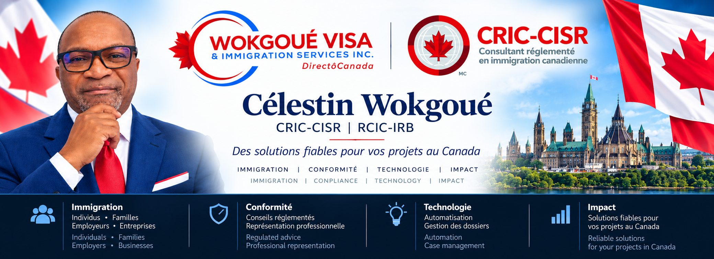

**Regulated Canadian Immigration Consultant (RCIC-IRB) | Consultant réglementé en immigration canadienne (CRIC-CISR)**

📍 Gatineau, Québec, Canada

## 🇫🇷 Bienvenue

Je suis **Célestin Wokgoué**, consultant réglementé en immigration canadienne (CRIC-CISR) et fondateur de **Wokgoué Visa & Immigration Services Inc.** (wviscanada), établi à Gatineau, au Québec.

Ma pratique porte sur l'immigration canadienne et québécoise, la représentation des clients, la conformité réglementaire et la gestion des dossiers d'immigration.

Je m'intéresse également aux applications concrètes du développement logiciel, de l'intelligence artificielle et de l'automatisation responsable dans les services professionnels.

## 🇨🇦 Welcome

I am **Célestin Wokgoué**, a Regulated Canadian Immigration Consultant (RCIC-IRB) and founder of **Wokgoué Visa & Immigration Services Inc.** (wviscanada), based in Gatineau, Québec, Canada.

My practice focuses on Canadian and Québec immigration, client representation, regulatory compliance, and immigration case management.

I am also interested in practical applications of software development, artificial intelligence, and responsible automation in professional services.

## 🚀 WVIS-OS-App | Immigration Practice Technology

**Statut / Status: Active development / Développement en cours**

**FR :** WVIS-OS-App est un projet de développement logiciel visant à soutenir la gestion des dossiers d'immigration et l'organisation des activités d'un cabinet. Les fonctionnalités et les capacités de la plateforme évoluent au fil du développement.

**EN:** WVIS-OS-App is a software development project focused on immigration case management and professional practice workflows. Platform features and capabilities are evolving as development progresses.

> Le code source, la documentation interne et les informations confidentielles du projet ne sont pas publiés ici.  
> Source code, internal documentation, and confidential project information are not published here.

## 💻 Domaines d'intérêt | Areas of Interest

- Gestion des dossiers d'immigration | Immigration case management
- Automatisation des processus | Workflow automation
- Intelligence artificielle responsable | Responsible AI
- Sécurité et confidentialité des données | Data privacy and security
- Qualité logicielle et conformité | Software quality and compliance

## 📜 Titres professionnels | Professional Credentials

| Français | English | Référence / Reference |
|---|---|---|
| Consultant réglementé en immigration canadienne (CRIC-CISR) | Regulated Canadian Immigration Consultant (RCIC-IRB) | **CCIC / CICC : R708543** |
| Reconnaissance au Québec | Québec recognition | **11979** |

## 🌐 Liens professionnels | Professional Links

- **Site web / Website :** [wviscanada.ca](https://wviscanada.ca)
- **Courriel / Email :** [info@wviscanada.ca](mailto:info@wviscanada.ca)
- **YouTube :** [@wviscanada](https://www.youtube.com/@wviscanada)
- **TikTok :** [@wviscanada.ca](https://www.tiktok.com/@wviscanada.ca)
- **Facebook :** [wviscanada](https://www.facebook.com/wviscanada)

**Professionnalisme • Innovation • Conformité**  
*Professionalism • Innovation • Compliance*

